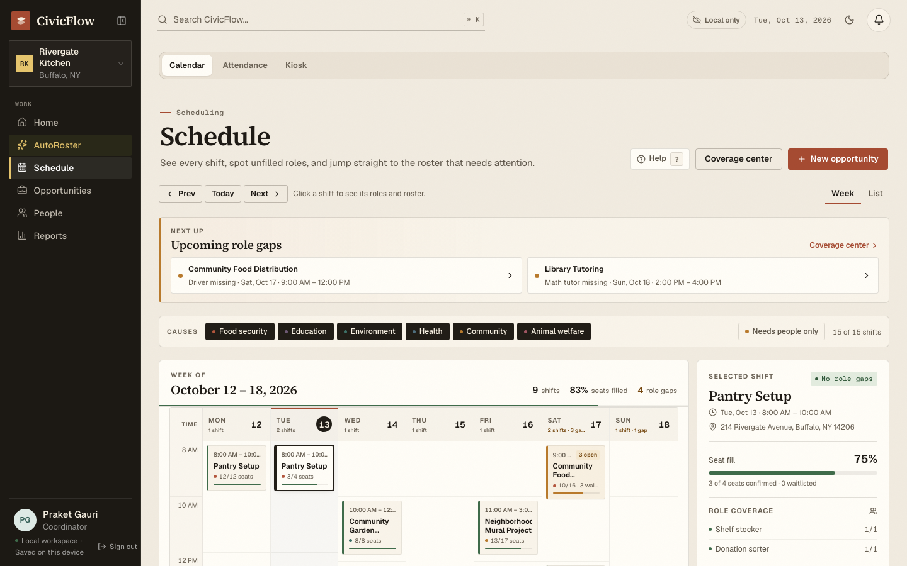
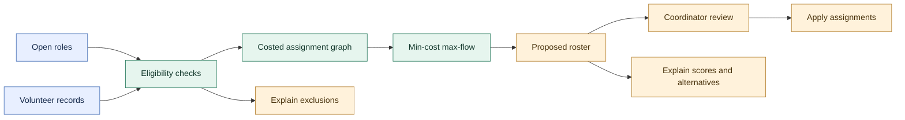
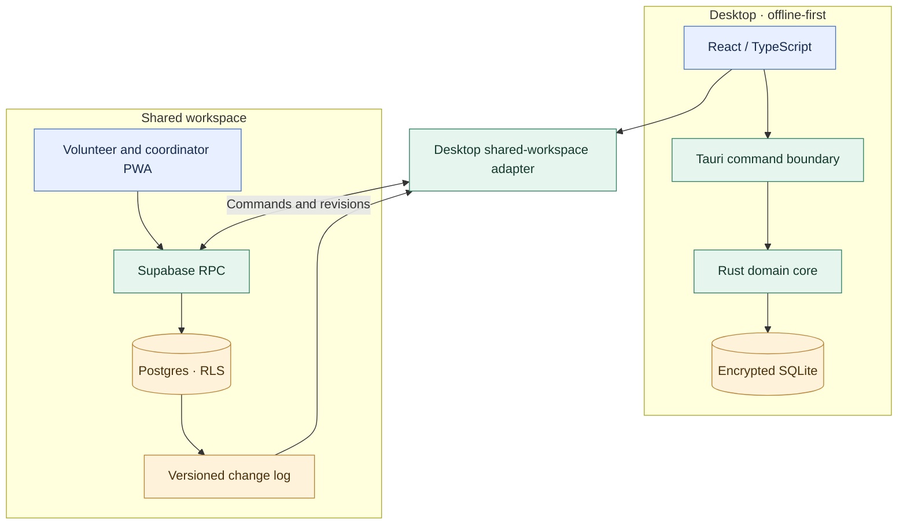

# CivicFlow

**Good volunteer programs deserve better than a spreadsheet.**

CivicFlow helps small nonprofits coordinate the people who make their work possible. A coordinator can publish an opportunity, schedule a shift, find qualified volunteers, track attendance, and report the hours served without juggling separate tools.

The desktop application works offline. Organizations that need to coordinate across devices can use a shared workspace with an installable volunteer web app.

[Open the interactive demo](https://civic-flow-demo.vercel.app/judge/demo/#/welcome) · [Project showcase](https://civic-flow-demo.vercel.app/judge/) · [Hosted volunteer app](https://civic-flow-demo.vercel.app/)

[](https://github.com/Praket7/civic-flow/actions/workflows/ci.yml) [](LICENSE)

## Screenshots

| Coordinator home | AutoRoster |
| :---: | :---: |
|  |  |



| Volunteer schedule | Volunteer home |
| :---: | :---: |
|  |  |

## Core capabilities

| For coordinators | For volunteers |
| --- | --- |
| Publish opportunities, shifts and recurring schedules | Find opportunities and register for shifts |
| Manage skills, credentials and availability | Review upcoming service and notifications |
| Fill open roles with AutoRoster | Check in and out of scheduled service |
| Review attendance, service hours and records | Submit hours and see verified service history |
| Export reports and printable funder packets | Use the installable shared-workspace web app |

## AutoRoster

Finding the right volunteer is not simply a matter of filling the next empty slot. A role may require a credential, a volunteer may already have a conflicting shift, and an organization may need to distribute work fairly.

AutoRoster models staffing as a deterministic min-cost max-flow problem. It excludes ineligible assignments, ranks the remaining choices using the configured policy, and returns a proposed roster with explanations. Coordinators review the proposal before applying it.



## Architecture



The Rust core owns local authorization, scheduling, matching, reporting and migrations. Shared workspaces use server-authoritative commands, stable operation IDs and revision checks. The hosted interface supports volunteer workflows and a narrower set of coordinator tools than the desktop application.

<!-- CIVICFLOW_FACTS_START -->
| Fact | Value |
| --- | --- |
| Package version | `0.1.2` |
| Registered routes | 57 |
| Migration files | 15 |
| Database schema | v15 |
| Application tables | 51 |
<!-- CIVICFLOW_FACTS_END -->

For implementation details, see [architecture](docs/architecture.md).

## Install and releases

### Download CivicFlow

**Version 0.1.2 · Evaluation edition** · [Release notes](https://github.com/Praket7/civic-flow/releases/tag/evaluation-0.1.2-9903b49e6b1c) · [SHA-256 checksums](https://github.com/Praket7/civic-flow/releases/download/evaluation-0.1.2-9903b49e6b1c/SHA256SUMS.txt) · [All releases](https://github.com/Praket7/civic-flow/releases)

| Platform | Architecture | Download |
| --- | --- | --- |
| macOS | Apple silicon and Intel (universal) | [Download DMG](https://github.com/Praket7/civic-flow/releases/download/evaluation-0.1.2-9903b49e6b1c/CivicFlow_0.1.2_universal_evaluation.dmg) |
| Windows | x64 | [Download EXE](https://github.com/Praket7/civic-flow/releases/download/evaluation-0.1.2-9903b49e6b1c/CivicFlow_0.1.2_x64-setup.exe) · [Download MSI](https://github.com/Praket7/civic-flow/releases/download/evaluation-0.1.2-9903b49e6b1c/CivicFlow_0.1.2_x64_en-US.msi) |
| Linux | x86_64 (Ubuntu 24.04) | [.deb package build status](https://github.com/Praket7/civic-flow/actions/workflows/evaluation-builds.yml) · [Build from source](#development) |
| Web | Modern browser | [Open CivicFlow](https://civic-flow-demo.vercel.app/) · [Project showcase](https://civic-flow-demo.vercel.app/judge/) |

The linked macOS and Windows evaluation packages passed installation and startup tests on GitHub-hosted runners. The Linux package will be available in [Releases](https://github.com/Praket7/civic-flow/releases) after its build and installation checks pass. Evaluation builds are not notarized or signed by a trusted publisher. They are intended for evaluation with fictional data.

### macOS

1. Download the DMG and verify its checksum against the release's SHA256SUMS.txt.
2. Open the disk image and drag CivicFlow into Applications.
3. Open CivicFlow from Applications. If macOS blocks the app solely because the developer is unidentified or the app is not notarized, and you have independently verified and trust the download, use the per-app **Open Anyway** option under System Settings → Privacy & Security after attempting to launch it.
4. Follow the confirmation prompt. If macOS reports malware, tampering, or a managed-device restriction, stop and use the web version instead.

See [Apple's guidance for opening apps safely](https://support.apple.com/en-us/102445). Do not disable Gatekeeper or remove security attributes globally.

### Windows

1. Download the EXE (recommended for interactive installation) or MSI (alternative package).
2. Verify the checksum and scan the file with Windows Security.
3. Open the installer and follow the setup wizard. If SmartScreen displays an unfamiliar-publisher warning, only use its **More info → Run anyway** option when available and when you have verified and trust the installer.
4. Launch CivicFlow from the Start menu. Do not disable Defender, Smart App Control, or organization-managed security policies. If installation is blocked, use the web version or ask your administrator.

### Linux

For the Ubuntu 24.04 x86_64 package, download the `.deb` from the evaluation release when available, verify its checksum, and install it with:

```sh
sudo apt install ./CivicFlow_0.1.2_amd64.deb
```

Use the actual downloaded filename if it differs. Launch CivicFlow from the applications menu. Other distributions may require a source build; see the [Tauri Linux prerequisites](https://v2.tauri.app/start/prerequisites/).

### Verify your download

Download the matching [SHA256SUMS.txt](https://github.com/Praket7/civic-flow/releases/download/evaluation-0.1.2-9903b49e6b1c/SHA256SUMS.txt) from the same release as the installer. Compare the complete hash for your file:

```sh
# macOS
shasum -a 256 CivicFlow_0.1.2_universal_evaluation.dmg
# Linux (use the actual downloaded filename)
sha256sum CivicFlow_0.1.2_amd64.deb
```

```powershell
Get-FileHash .\CivicFlow_0.1.2_x64-setup.exe -Algorithm SHA256
```

GitHub CLI users can additionally verify build provenance with `gh attestation verify <installer-path> --repo Praket7/civic-flow`. A checksum confirms file integrity against the published manifest; it does not replace publisher signing.

The hosted app requires authentication and an authorized workspace invitation. The browser-local sample and evaluation workspaces are intended for fictional records. For real organization enrollment, see [deployment](docs/deployment.md) and [operations](docs/operations.md).

## Development

Use the Node version in [`.node-version`](.node-version), the exact pnpm version in [`.pnpm-version`](.pnpm-version), stable Rust and the [Tauri prerequisites](https://v2.tauri.app/start/prerequisites/). Different pnpm versions can report different dependency inventories; use the pinned version before regenerating notices.

```sh
pnpm install --frozen-lockfile
pnpm dev
pnpm tauri dev
```

The browser preview opens at http://localhost:5173. The desktop app includes a fictional workspace that works without a network connection.

See [contributing](CONTRIBUTING.md) for conventions and review expectations.

## Testing and quality

```sh
pnpm verify
pnpm test:sql
pnpm test:hosted
pnpm test:ops
```

Tests cover React interactions, Rust business rules, shared database authorization, synchronization, report reconciliation, accessibility, printing and native desktop journeys. CI also checks dependency advisories, secrets, build budgets and platform compilation.

See [test organization](docs/testing.md) for the test matrix and individual commands.

## Maintainers

Praket Gauri, Samanyu Mergu and Yash Vepuri.

## License and acknowledgements

Source code is available under the [MIT License](LICENSE). See [third-party notices](THIRD_PARTY_NOTICES.md) and [media licenses](public/media/LICENSE.md) for bundled dependencies, photography and other assets.

[Security policy](SECURITY.md) · [Changelog](CHANGELOG.md) · [Contributing](CONTRIBUTING.md)
