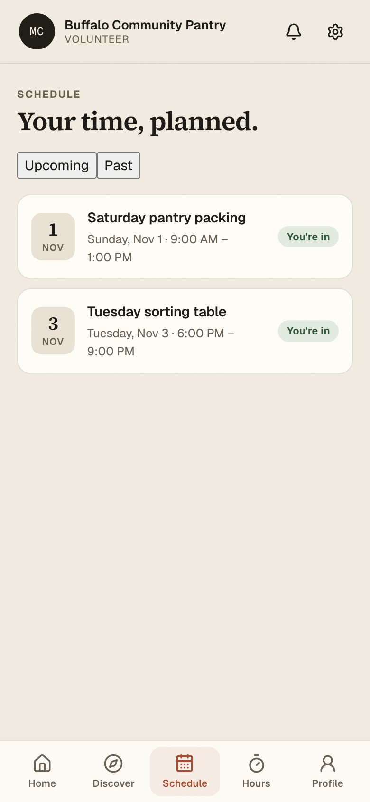
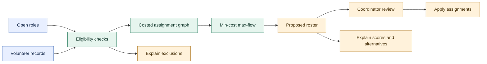
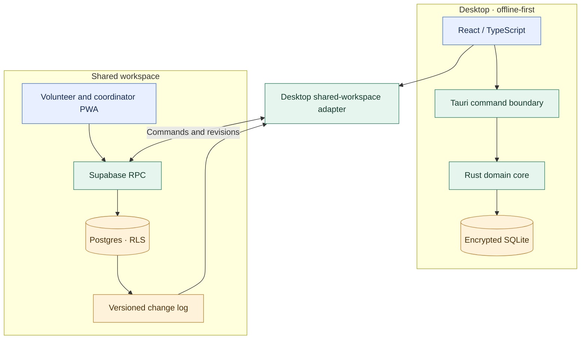

# CivicFlow

**Good volunteer programs deserve better than a spreadsheet.**

CivicFlow helps small nonprofits coordinate the people who make their work possible. A coordinator can publish an opportunity, schedule a shift, find qualified volunteers, track attendance, and report the hours served without juggling separate tools.

The desktop application works offline. Organizations that need to coordinate across devices can use a shared workspace with an installable volunteer web app.

[Open the interactive demo](https://civic-flow-demo.vercel.app/judge/demo/#/welcome) · [Project showcase](https://civic-flow-demo.vercel.app/judge/) · [Hosted volunteer app](https://civic-flow-demo.vercel.app/)

[](https://github.com/Praket7/civic-flow/actions/workflows/ci.yml) [](LICENSE)

## Screenshots

| Coordinator home | AutoRoster |
| :---: | :---: |
|  |  |


| Volunteer schedule | Volunteer home |
| :---: | :---: |
|  |  |

## Core capabilities

| For coordinators | For volunteers |
| --- | --- |
| Publish opportunities, shifts and recurring schedules | Find opportunities and register for shifts |
| Manage skills, credentials and availability | Review upcoming service and notifications |
| Fill open roles with AutoRoster | Check in and out of scheduled service |
| Review attendance, service hours and records | Submit hours and see verified service history |
| Export reports and printable funder packets | Use the installable shared-workspace web app |

## AutoRoster

Finding the right volunteer is not simply a matter of filling the next empty slot. A role may require a credential, a volunteer may already have a conflicting shift, and an organization may need to distribute work fairly.

AutoRoster models staffing as a deterministic min-cost max-flow problem. It excludes ineligible assignments, ranks the remaining choices using the configured policy, and returns a proposed roster with explanations. Coordinators review the proposal before applying it.



## Architecture



The Rust core owns local authorization, scheduling, matching, reporting and migrations. Shared workspaces use server-authoritative commands, stable operation IDs and revision checks. The hosted interface supports volunteer workflows and a narrower set of coordinator tools than the desktop application.

<!-- CIVICFLOW_FACTS_START -->
| Fact | Value |
| --- | --- |
| Package version | `0.1.2` |
| Registered routes | 57 |
| Migration files | 15 |
| Database schema | v15 |
| Application tables | 51 |
<!-- CIVICFLOW_FACTS_END -->

For implementation details, see [architecture](docs/architecture.md).

## Install and releases

[Evaluation installers](https://github.com/Praket7/civic-flow/releases) are available for macOS (universal) and Windows (x64), with SHA-256 checksums and GitHub build provenance. These are test builds, not notarized or publisher-signed production installers. The [legacy v0.1.2 release](https://github.com/Praket7/civicflow2/releases/tag/v0.1.2) belongs to the original repository and is not a build of this revision. Do not bypass operating-system security warnings for untrusted installers.

The interactive demo uses fictional, browser-local records and requires no account. The hosted app uses Supabase authentication and requires an authorized workspace invitation. Do not enter real volunteer data in the demo.

Before enrolling real organizations, complete the [deployment](docs/deployment.md) and [operations](docs/operations.md) checks, including hosted role isolation, restore rehearsal and signed release verification. A successful build alone does not establish production readiness.

## Development

Use the Node version in [`.node-version`](.node-version), the exact pnpm version in [`package.json`](package.json), stable Rust and the [Tauri prerequisites](https://v2.tauri.app/start/prerequisites/). Different pnpm versions can report different dependency inventories; use the pinned version before regenerating notices.

```sh
pnpm install --frozen-lockfile
pnpm dev
pnpm tauri dev
```

The browser preview opens at http://localhost:5173. The desktop app includes a fictional workspace that works without a network connection.

See [contributing](CONTRIBUTING.md) for conventions and review expectations.

## Testing and quality

```sh
pnpm verify
pnpm test:sql
pnpm test:hosted
pnpm test:ops
```

Tests cover React interactions, Rust business rules, shared database authorization, synchronization, report reconciliation, accessibility, printing and native desktop journeys. CI also checks dependency advisories, secrets, build budgets and platform compilation.

See [test organization](docs/testing.md) for the test matrix and individual commands.

## Maintainers

Praket Gauri, Samanyu Mergu and Yash Vepuri.

## License and acknowledgements

Source code is available under the [MIT License](LICENSE). See [third-party notices](THIRD_PARTY_NOTICES.md) and [media licenses](public/media/LICENSE.md) for bundled dependencies, photography and other assets.

[Security policy](SECURITY.md) · [Changelog](CHANGELOG.md) · [Contributing](CONTRIBUTING.md)
