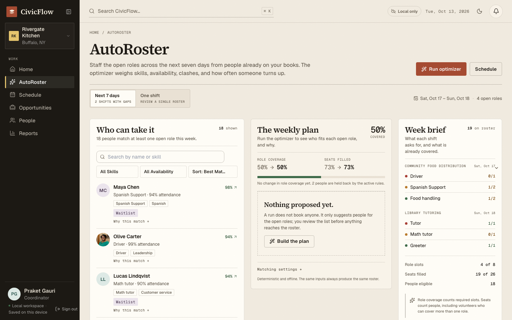
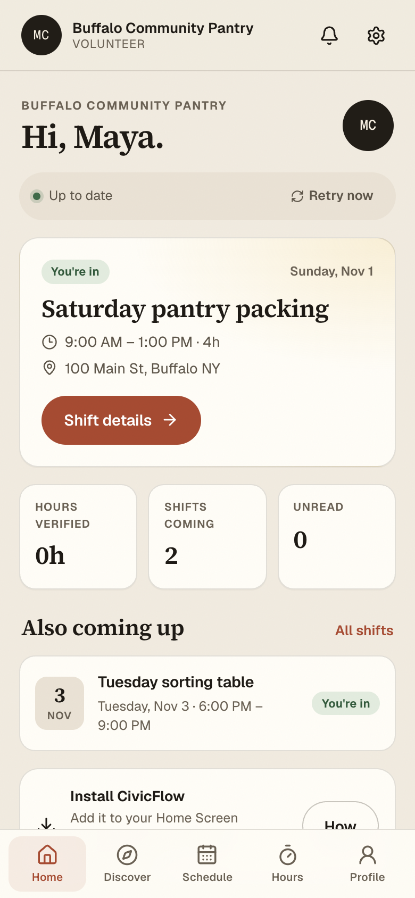

# CivicFlow

CivicFlow is a volunteer coordination platform for small nonprofits. Coordinators publish opportunities and shifts, staff open roles, track attendance and service hours, manage volunteer records, and report outcomes. Volunteers find service, register, check in, and keep a record of their contributions.

The desktop application is local-first: its workspace, scheduling, reporting, check-in, and AutoRoster features work without a network connection. An optional shared workspace connects the desktop and an installable volunteer PWA through Supabase for organizations that need multiple devices.

<!-- CIVICFLOW_FACTS_START -->
| Fact | Value |
| --- | --- |
| Package version | `0.1.2` |
| Registered routes | 57 |
| Migration files | 15 |
| Database schema | v15 |
| Application tables | 51 |
<!-- CIVICFLOW_FACTS_END -->

## Screenshots

| Coordinator home | AutoRoster |
| --- | --- |
|  |  |
| **Volunteer schedule** | **Volunteer home** |
|  |  |


## Core capabilities

- Opportunities, shifts, roles, weekly series, and capacity.
- Volunteer records, skills, availability, credentials, and applications.
- AutoRoster planning with an explanation for every assignment.
- Check-in, attendance, no-shows, and a check-in kiosk.
- Service-hour submission, review, approval, and records.
- Reports, CSV export, and a printable funder packet.
- An encrypted local SQLite workspace that works offline.
- An optional shared workspace and installable volunteer PWA.

## AutoRoster

AutoRoster assigns volunteers to open roles while respecting availability, conflicts, credentials, skills, age rules, rest requirements, and workload limits. It can fill one shift or review every upcoming gap.

The planner uses deterministic min-cost max-flow optimization. For every proposed assignment it reports the hard checks and score components, and it can compare an assigned volunteer with an eligible alternative.

## Architecture

```text
Desktop                                   Shared workspace
React 19 + TypeScript                     Volunteer PWA
        |                                        |
        v                                        v
Tauri 2 commands                          Supabase RPC
        |                                        |
        v                                        v
civicflow-core (Rust)                     Postgres
        |                                        |
        v                                        v
SQLite workspace                          change log + commands
```

- `src-tauri/core` owns the schema, migrations, authorization, workflow rules, matching, reporting, backups, and audit events. It has no Tauri dependency and is tested with `cargo test`.
- The desktop writes to local SQLite first. React reads one snapshot through the repository boundary; screens do not keep private copies of records.
- The shared workspace uses the server as the authority. Writes are queued locally, retried with stable operation IDs, and refused rather than silently merged when the server has newer data.
- The volunteer PWA and the desktop's shared view use the same Rust planner and the same synchronized data model.

For an exit-gate-by-exit-gate review, see the [public release readiness audit](docs/PUBLIC-RELEASE-READINESS.md). The current source is not approved for unrestricted public launch.

## Web surfaces and data boundaries

**Build targets are intentionally different.** The native Tauri build runs
`pnpm build:web`, keeping `index.html` as the local demonstration and
`pwa.html` as the separately embedded real Supabase client. The browser
preview cannot sign in to local browser-only accounts in production and must
not hold real volunteer information.

For an independently hosted website, `pnpm build:hosted` first validates
the **publishable/anon** `VITE_SUPABASE_ANON_KEY` (never a service-role key),
builds the same source, then replaces the compiled root `dist/index.html`
with the real `pwa.html` entrypoint. `vercel.json` uses this dedicated
hosted build. It fails rather than silently deploying a localStorage demo
when configuration is absent. The original source files and Tauri build
remain unchanged.

The hosted PWA supports authenticated volunteers and a narrower coordinator
view with live workspace health, reminder history, and RLS-scoped upcoming
shifts. **This is not the full desktop coordinator interface.** Browser
AutoRoster editing, full service-hour approval and full reporting still need
server-backed UI development and real multi-account acceptance testing.

The preview is never a substitute for an organization database. A successful
`build:hosted` proves the correct entrypoint was compiled, not that
production authentication, SMTP, backups or permissions were tested.

## Development

Use the Node version in `.node-version`, pnpm 12.9.1, stable Rust, and the platform's Tauri prerequisites.

```bash
pnpm install --frozen-lockfile
pnpm dev              # browser preview at http://localhost:5173
pnpm tauri dev        # native desktop window
pnpm verify           # local quality gate
pnpm test:hosted      # fail-closed production entrypoint tests
pnpm test:ops         # encrypted backup / restore script syntax
pnpm tauri build      # installers for this platform
```

The seeded demo workspace is available from the welcome screen and needs no account or network.

### Production operations before live enrollment

The Supabase Free plan does not automatically preserve daily project
backups. `scripts/backup-cloud.sh` streams a custom PostgreSQL dump
through **age encryption** directly into a private S3 bucket and requires
bucket-level public-access blocking. Its manual
`.github/workflows/backup-cloud.yml` workflow is deliberately restricted
to `main` and a GitHub `backup-production` environment: enable required
environment reviewers and protect `main` before configuring
`CIVICFLOW_DATABASE_URL`, `CIVICFLOW_BACKUP_AGE_RECIPIENT`,
`CIVICFLOW_BACKUP_S3_URI`, and the OIDC
`CIVICFLOW_BACKUP_ROLE_ARN`. An upload **is not a verified restore**.

`scripts/verify-cloud-restore.sh` decrypts an archived object through a
pipe to an explicitly authorized disposable **localhost**
`civicflow_restore_*` PostgreSQL database. Keep the age private identity
off the repository and GitHub logs. Rehearse a real restore and separately
validate membership, authentication and application records before approving
release. No test or workflow invents successful `backup_runs` records.

`.github/workflows/hosted-auth-smoke.yml` is an opt-in, read-only test
against three actual staging accounts in two organizations; provide the
account credentials through the protected `hosted-staging` environment.
Until it runs successfully, synthetic SQL role tests are not equivalent to
a live hosted-account acceptance test.

## Testing and quality

`pnpm verify` runs the TypeScript typecheck, ESLint, Prettier, generated-file checks, unit tests, SQL protocol tests, the web build, browser accessibility and print audits, Rust formatting, Clippy, and the Rust test suite.

CI additionally runs the macOS native end-to-end test with WebdriverIO, dependency audits in both Cargo workspaces, a production pnpm audit, and a gitleaks secret scan. The SQL suite applies every Supabase migration to PGlite and exercises row-level security, commands, sync, check-in, and reminders.

## Install and releases

**Release status:** This repository contains the reviewed CivicFlow source and Phase 1 authorization changes, but it has not published a verified installer release. The links below point to **legacy v0.1.2 installers** in the original repository, not new builds from `civic-flow`.

[Download the previous CivicFlow release](https://github.com/Praket7/civicflow2/releases/latest) for macOS, Windows, or Linux. The macOS asset is one universal DMG for Apple silicon and Intel Macs; the Windows and Linux releases contain the x64 installers for those platforms.

| Platform | Direct download |
| --- | --- |
| macOS | [Universal DMG](https://github.com/Praket7/civicflow2/releases/download/v0.1.2/CivicFlow_0.1.2_universal.dmg) (Apple silicon and Intel) |
| Windows 10/11 | [x64 installer](https://github.com/Praket7/civicflow2/releases/download/v0.1.2/CivicFlow_0.1.2_x64-setup.exe) or [MSI](https://github.com/Praket7/civicflow2/releases/download/v0.1.2/CivicFlow_0.1.2_x64_en-US.msi) |
| Linux | [AppImage](https://github.com/Praket7/civicflow2/releases/download/v0.1.2/CivicFlow_0.1.2_amd64.AppImage), [deb](https://github.com/Praket7/civicflow2/releases/download/v0.1.2/CivicFlow_0.1.2_amd64.deb), or [rpm](https://github.com/Praket7/civicflow2/releases/download/v0.1.2/CivicFlow-0.1.2-1.x86_64.rpm) |

[Download `SHA256SUMS.txt`](https://github.com/Praket7/civicflow2/releases/download/v0.1.2/SHA256SUMS.txt) before running an installer.

Installers are built by `.github/workflows/release.yml` when a `v*` tag is pushed. The workflow verifies the exact tagged commit and builds draft release assets with SHA-256 checksums and GitHub build provenance. The draft must pass signed installer, migration, and clean-install verification before a maintainer publishes it. Verify a download with `shasum -a 256 -c SHA256SUMS.txt` (macOS/Linux) or `Get-FileHash <file> -Algorithm SHA256` (Windows), and verify provenance with `gh attestation verify <installer> --repo Praket7/civicflow2`.

Previously published installers may lack signing or notarization. Verify provenance and publisher identity before using them; do not bypass Gatekeeper or SmartScreen warnings for an untrusted binary. New public releases are blocked unless signing credentials are configured. Follow [`docs/RELEASE-CHECKLIST.md`](docs/RELEASE-CHECKLIST.md) for versioning, signing, and the clean-install matrix. The legacy installers continue to use the original repository's updater feed. New builds from `civic-flow` use this repository's releases; do not assume the old 0.1.2 installers will discover a release here automatically. The first new release must include a verified signing key and signed `latest.json` feed.

## License and acknowledgements

CivicFlow is released under the [MIT License](LICENSE). The generated [third-party notices](THIRD_PARTY_NOTICES.md) list the direct dependencies and licenses. Bundled photography and fonts are credited in the in-app credits screen and in [`public/media/LICENSE.md`](public/media/LICENSE.md).
