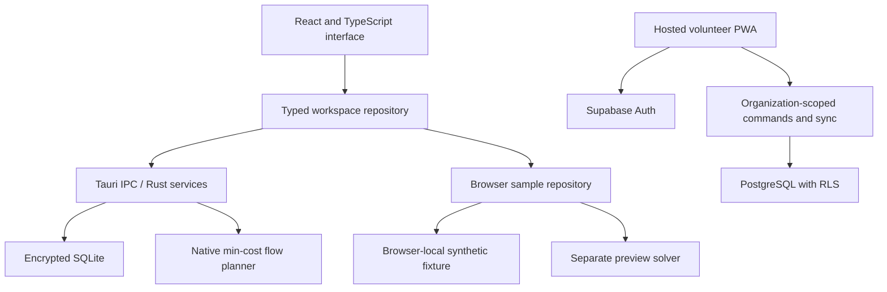

# Stage 8 — competition release verification

## Scope and release identity

Stage 7 engineering PR [#21](https://github.com/Praket7/civic-flow/pull/21) was merged at `ad314509326320eef3064c1235923a6c4655549d`. The tree matched its nine-check green candidate. The owner deferred separate hosted staging, production migration reconciliation, backup/restore, scheduled delivery credentials, signed installers, repository protections and participant testing. These are not certified by this stage.

Stage 8 freezes a synthetic competition candidate, not a production release. The evidence workflow checks out the exact candidate SHA, checks all four version manifests, runs the browser journey with a loopback-only proxy, renders the actual PDF export, reconciles extracted source values, rasterizes every PDF page, and generates SHA-256 digests of the evidence. The package version remains 0.1.2; the hash distinguishes this candidate from old published 0.1.2 installers. Do not publish a tag or treat the old installers as this build.

## Decision record

- [Official FBLA 2026–27 national event guidelines](https://www.fbla.org/competitive-events/coding-programming/): 110-point presentation, 3-minute setup, 7-minute presentation, 3-minute Q&A. A standalone program and backup for unreliable internet matter; judges must not click links or QR codes. Competitors are responsible for their own presentation preparation. Review the current Honor Code, attribution requirements and adviser instructions before competing.
- [NIST SSDF 1.1](https://csrc.nist.gov/pubs/sp/800/218/final): retain source and release integrity evidence rather than trusting an unlabeled screenshot or mutable URL. Hashes establish byte integrity, not signing identity or production deployment.
- [WCAG 2.2 keyboard guidance](https://www.w3.org/WAI/WCAG22/Understanding/keyboard): automated audits and responsive evidence support review, but actual keyboard and assistive-technology testing remains necessary.
- [AutoRoster research and correctness record](FBLA-STAGE3-AUTOROSTER.md): reproducible synthetic baseline, explainable hard constraints, independent audit and specialist scarcity; no inference about attendance or nonprofit outcomes.
- [Reporting correctness record](FBLA-STAGE4-REPORTING.md): provenance, approved vs requested minutes, filters, row identities and export consistency. PDF layout and extracted contents are tested independently of HTML.

## National rating-sheet evidence map

This maps criteria to independently verifiable product evidence, not a self-awarded score. Use the official rating sheet for exact language and scoring.

| Criterion                             | Maximum | Evidence                                                            | Independent check                                |
| ------------------------------------- | ------: | ------------------------------------------------------------------- | ------------------------------------------------ |
| Language selection                    |       5 | README architecture: TypeScript/React, Rust/Tauri, SQLite, Postgres | Explain language and runtime tradeoffs           |
| Naming, comments, formatting          |       5 | Matching flow and report modules                                    | Inspect source; lint, format, Clippy             |
| Modularity                            |      10 | Core matching, reports, sync, typed frontend boundaries             | Trace one command from UI to persistence         |
| UX rationale, journeys, accessibility |      10 | Stage 5/6 docs; browser captures                                    | Walk through both roles; keyboard and 200% zoom  |
| Intuitive instructions                |       5 | Onboarding, help and validation                                     | Fresh profile and unfamiliar user                |
| Navigation and intelligent feature    |       5 | AutoRoster, contextual help                                         | Compare eligible and blocked candidates          |
| Input validation                      |       5 | Opportunity validator, native policy tests                          | Try invalid capacity and invalid attendance code |
| Prompt relevance                      |      10 | Opportunity, schedule, signup, staffing, attendance, approval       | Connected browser and native journey             |
| Presentable reports                   |      10 | Known-answer ledger, CSV, actual PDF and filters                    | Match source rows and rendered export            |
| Data storage and scope                |       5 | Encrypted SQLite, typed collections and transaction boundaries      | Explain persisted vs ephemeral data              |
| Organization and clarity              |      10 | Competitor-authored presentation                                    | Independent timed rehearsal                      |
| Delivery and confidence               |      10 | Competitor practice                                                 | Observer feedback, not automated                 |
| Questions                             |      10 | Competitor technical understanding                                  | Unscripted architecture and algorithm questions  |
| Protocol                              |      10 | Current national event rules                                        | Competitor verifies devices, timing, conduct     |

Total maximum: 110 points. New York prejudging is separate; see [Stage 2 traceability](FBLA-STAGE2-RUBRIC-TRACEABILITY.md). The [2027 New York SLC mailing](https://www.nysfbla.org/wp-content/uploads/2026/09/SLC-HS-Mailing-Email-Blast-2.pdf) lists January 15, 2027 at 11:59 p.m. for Coding & Programming materials in Blue Panda. Confirm the current state deadline and required URL with the chapter adviser. Never claim a national placement or rubric score from CI.

## Technical rehearsal worksheet (competitor prepares their own presentation)

Use the 7-minute limit as a hard constraint. Time a single uninterrupted attempt and record the actual outcome; do not concatenate screenshots to claim live completion. Start from a fresh, seeded synthetic workspace. Suggested technical milestones to independently select and rehearse: create a program and one shift; volunteer discovery and request; coordinator eligibility and plan audit; explicit apply; recipient notification and schedule; attendance and pending/verified records; filter and export the report. The fixed sample clock is intentionally synthetic. Stage 6's automated journey tests two connected sequences; it does not prove every milestone is performed in one seven-minute live session.

Questions for self-study: Why Rust and SQLite? What are the min-cost-flow graph and constraints? Where does the browser preview differ? How is a stale plan rejected? What happens to a pending hour entry? How do sync revision and operation IDs interact? How does authorization differ in local and hosted modes? What is not deployed or independently validated? Which code and assets were created by the competitor, and what assistance or third-party materials were used? Read the source and answer in your own words.

## Evidence and exit conditions

- Exact candidate: manifest.json in the successful Stage 8 workflow artifact, with source SHA, version, PDF page count, row count and per-file hashes.
- Actual report: report.pdf, report.csv, report-source-rows.json, report-rendered-text.txt and raster images. Text presence is not proof of full visual correctness; inspect each raster page.
- Known-answer fixture: 75 approved minutes, 100 pending minutes, one rejected claim, two verified volunteers, excluded August row. See the exact tests in Stage 4.
- Measured optimizer: benchmark.txt and toolchain.txt, 24/12, 120/35, 300/80 comparison and 1,000/250 repeatability. Timings are hardware-specific debug-build observations, not performance promises.
- Journey: twelve screenshots and browser-journey.txt. The loopback-only browser test is not a cold-start standalone desktop installation. Verify a separately built desktop app with Wi-Fi off before the event.
- Accessibility: full CI audits, then actual keyboard and screen reader review; no automated certification.
- Submission: independently verify official state/national requirements, filenames and URL permissions; open the live judging URL without cookies; verify exact Vercel production deployment; preserve hashes, source and third-party notices. Carry charged permitted devices and offline backup, do not leave anything with judges.
- Human evidence: record anonymous participant code, device, task, time, outcome, errors, assistance, issues and retest. No invented participants or results. Complete blind timed rehearsals and clean-device verification.

Stage 8 is not fully accepted until real-device, participant and competitor-led submission/presentation checks are recorded. Keep the PR candidate distinct from a published release.

## Architecture study reference

The following is an engineering map, not a ready-to-submit competition slide. Inspect the implementation and draw your own explanation.

Source anchors for independent code study:

- `src-tauri/core/src/matching/flow.rs` and `src-tauri/core/src/matching/planner.rs`: graph flow and planner logic; `src-tauri/core/tests/roster_performance.rs`: controlled baseline and repeatability.
- `src/features/coverage/planAudit.test.ts`: independent proposal audit; `src/lib/workspace/preview/rosterEngine.ts`: separate browser implementation.
- `src-tauri/core/src/reports.rs` and `src/lib/workspace/preview/reports.test.ts`: source-to-output model and known-answer fixture.
- `src-tauri/core/src/auth.rs`, `src-tauri/core/src/authorization.rs`, `src-tauri/core/src/sync/protocol.rs`: authentication, authorization and operation semantics.
- `scripts/audit-judge-flow.mjs`: actual UI journey, CSV parity and rendered PDF capture.

The internal installer workflow can produce unsigned macOS and Windows artifacts for authorized local evaluation only. Never bypass an OS trust warning, substitute a legacy installer for the frozen candidate or represent an unsigned build as a verified commercial release.
