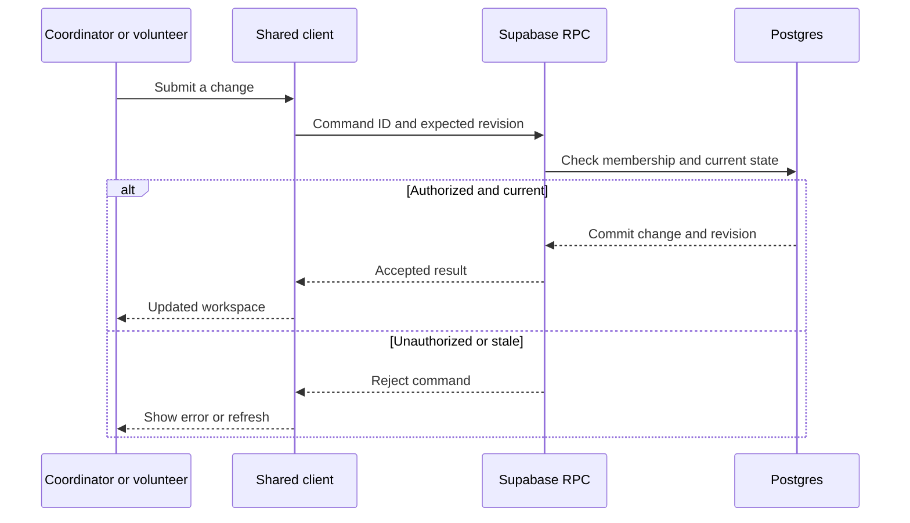

# Architecture

CivicFlow has two execution environments: a native desktop application that works offline and a shared workspace backed by Supabase. They share domain concepts, but their persistence and trust boundaries differ.

## Desktop

React renders the workspace and invokes native commands through Tauri. The Rust core validates requests and owns the encrypted SQLite database, schema migrations, authorization, roster planning and reports.

The browser preview is a separate demonstration adapter, not the native encrypted database. It must never be treated as secure storage for real nonprofit records.

## Shared workspace

The hosted PWA authenticates users through Supabase. Database policies and RPC functions enforce organization membership and role permissions. Shared commands carry stable operation identifiers and revision information; a stale update must not silently replace newer server data.

## Source layout

- `src/app`: application shell, routes and authentication boundaries.
- `src/features`: feature screens and workflows.
- `src/components`: reusable UI and accessibility components.
- `src/lib`: data adapters, synchronization, formatting and domain utilities.
- `src/pwa`: installable shared-workspace client.
- `src-tauri/core`: native business rules, SQLite and Rust tests.
- `supabase`: database migrations, edge functions and database tests.
- `shared`: fixtures and contracts used across implementations.

AutoRoster uses a deterministic min-cost max-flow planner in the Rust core. Shared policy fixtures test agreement between implementations. See [testing](testing.md) for the verification commands.

The hosted coordinator interface does not yet expose every desktop feature.
