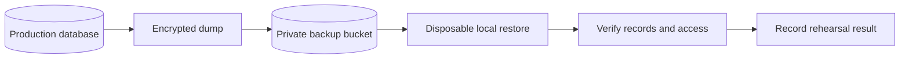

# Operations

## Backup and restore

The [cloud backup script](../scripts/backup-cloud.sh) streams a PostgreSQL dump through age encryption to a private S3 bucket. Configure its GitHub environment with restricted reviewers and a least-privilege OIDC role. Keep the age private identity outside the repository.

The [backup workflow](../.github/workflows/backup-cloud.yml) requires the database URL, age recipient, S3 destination and OIDC role configuration. Do not print those values in logs.

Use [the restore script](../scripts/verify-cloud-restore.sh) with an explicitly authorized disposable local PostgreSQL database. Never rehearse restoration over the production database.

A successful upload does not prove that the backup is restorable. Record the backup date, restore date, source revision, validation result and any discrepancies. Verify authentication and organization membership separately.

## Incident handling

If a credential is exposed, revoke or rotate it promptly and review its use. If organization isolation fails, suspend the affected access path and preserve relevant logs without exporting unnecessary personal data. Use the [security policy](../SECURITY.md) to coordinate disclosure.

## Hosted verification

Run the [hosted authentication smoke workflow](../.github/workflows/hosted-auth-smoke.yml) with authorized staging accounts in separate organizations. Keep test credentials in the protected staging environment.

Synthetic SQL tests are useful regression checks, but they do not replace live staging acceptance. Record actual results before approving enrollment.

## Routine checks

The hosted database advisor reports are a starting point, not a security certification. Review each privileged RPC before changing its grants; authenticated access may be intentional when the function checks organization membership and role.

The foreign-key index migration covers the observed missing indexes. Check the performance advisor again after applying it, and use query plans on representative staging data before claiming a speed improvement.

Review the Vercel runtime error view and the Supabase database and authentication logs. Do not include credentials, volunteer contact details, or request bodies in incident reports. A clean log window alone does not establish that the application is healthy.

The isolated recovery job exercises a synthetic database with no production credentials. Its result does not certify the encrypted production backup or the hosted authentication service. For a real restore rehearsal, follow the restricted backup and restore procedure above.

## Privileged client functions

The signed-in RPCs for commands, profiles, health, notification reads, workspaces, device registration, push subscriptions and notification preferences deliberately retain their authenticated grants. Each uses an explicit request identity or membership check, and the permission suite verifies that anonymous callers cannot execute them and that their search paths are fixed. Revoking legitimate client grants would break synchronization and notification settings.

Leaked-password protection is a managed Supabase Auth feature available on Pro and higher plans. The Free plan warning remains until an authorized owner upgrades and enables it. Client-side checks cannot substitute for enforcement by the authentication provider.

## Reminder scheduling

The [database scheduler provisioning script](../supabase/operations/enable-reminder-cron.sql) installs a hosted-only cron job at minutes 7, 22, 37 and 52 of each hour. It reads the public gateway JWT and project URL from Vault, then issues a five-minute, single-use credential for each request. The dispatcher retains the independent GitHub scheduler token as a fallback. Neither path requires a service-role key in the scheduler.

Verify the actual reminder job record and the cron history; a successful HTTP enqueue does not prove delivery. Revoke or disable the cron job before using a managed production snapshot in another project. The ordinary local migrations and synthetic restore do not activate the hosted scheduler.

For the offsite backup on the Free plan, provide an authorized PostgreSQL connection, a private storage destination, the public encryption recipient and the restricted OIDC role. Do not record a verified backup until the encrypted production archive has been restored and checked separately.
